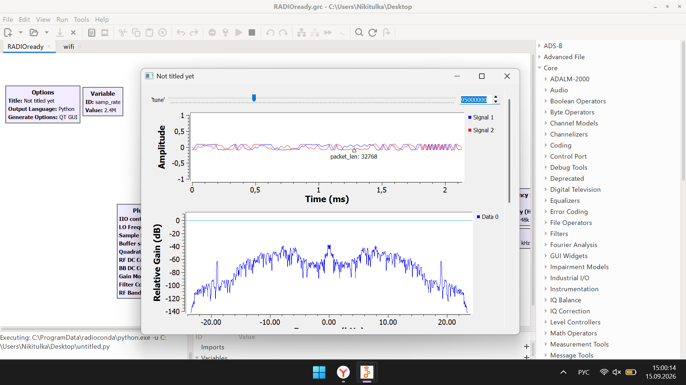
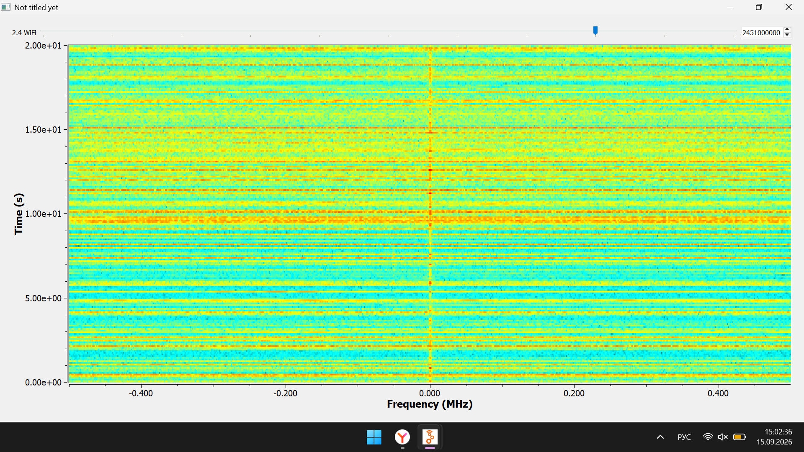
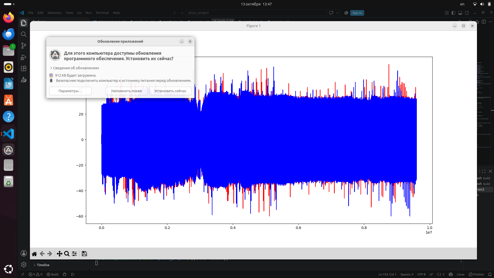
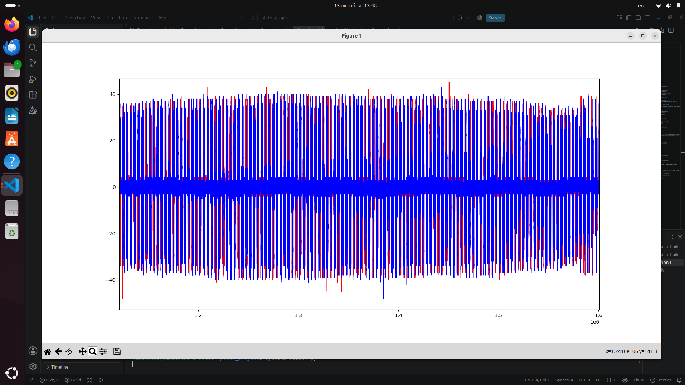
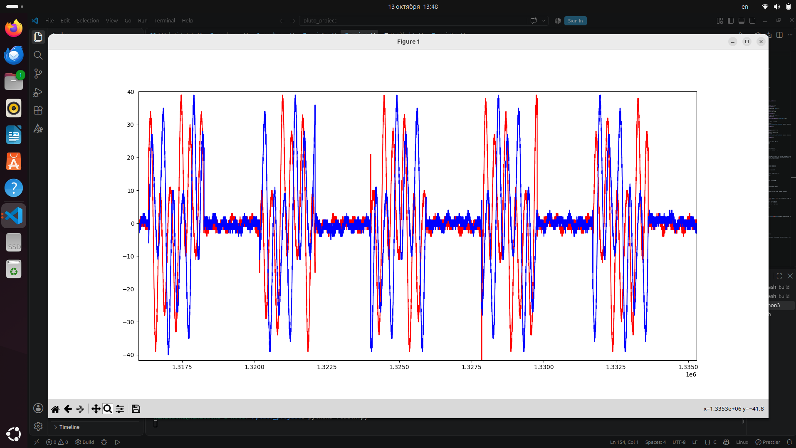
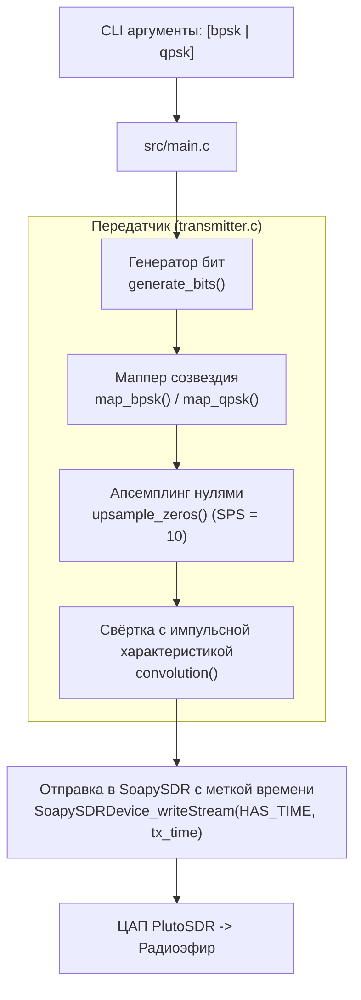

# Приемопередатчик на базе Adalm-Pluto SDR

Комплексный проект разработки программного обеспечения цифрового радиоприема и передачи данных на базе **ADALM-PLUTO (PlutoSDR)**. 

---

## Содержание

1. [Структура проекта](#структура-проекта)
2. [Требования и сборка](#требования-и-сборка)
3. [Инструкция по запуску](#инструкция-по-запуску)
4. [История разработки по неделям](#история-разработки-по-неделям)
   - [Неделя 1: Архитектура Pluto SDR. GNU Radio. Построение FM-радиоприёмника](#неделя-1-архитектура-pluto-sdr-gnu-radio-построение-fm-радиоприёмника)
   - [Неделя 2: Доработка радиоприёмника. Разработка Wi-Fi анализатора (2.4 ГГц)](#неделя-2-доработка-радиоприёмника-разработка-wi-fi-анализатора-24-ггц)
   - [Неделя 3: Прямое управление SDR на Си. SoapySDR, Libiio и аппаратные Timestamp](#неделя-3-прямое-управление-sdr-на-си-soapysdr-libiio-и-аппаратные-timestamp)
   - [Неделя 4: Взаимодействие между двумя устройствами Pluto SDR по радиоканалу](#неделя-4-взаимодействие-между-двумя-устройствами-pluto-sdr-по-радиоканалу)
   - [Неделя 5: Потоковая передача и запись радиосигналов](#неделя-5-потоковая-передача-и-запись-радиосигналов)
   - [Неделя 6: Рефакторинг монолита и разделение логики приёмника и передатчика](#неделя-6-рефакторинг-монолита-и-разделение-логики-приёмника-и-передатчика)
   - [Неделя 7: Цифровая модуляция BPSK/QPSK, генератор бит, апсемплинг и свёртка](#неделя-7-цифровая-модуляция-bpskqpsk-генератор-бит-апсемплинг-и-свёртка)

---

## Структура проекта

Файловая структура проекта реорганизована в классическую модульную структуру Си-приложений:

```text
├── CMakeLists.txt         # Конфигурация сборки проекта (CMake)
├── README.md              # Документация проекта и отчет по проделанной работе
├── readrx.py              # Скрипт визуализации квадратурных IQ-отсчетов (Matplotlib)
├── headers/               # Заголовочные файлы
│   ├── sdr_configures.h   # Структуры конфигурации SDR и прототипы функций управления потоками
│   └── TX.h               # Константы (SPS, TX_AMPLITUDE) и прототипы модуля передатчика
├── src/                   # Исходный код на языке C
│   ├── configure_sdr.c    # Разбор параметров CLI, инициализация SoapySDR, конфигурирование SDR
│   ├── transmitter.c      # Генерация бит, созвездия BPSK/QPSK, апсемплинг и свертка
│   └── main.c             # Точка входа, циклы приёма/передачи
├── screens/               # Иллюстрации, графики и осциллограммы результатов работы
└── third_party/           # Сторонние зависимости и библиотеки (зарезервировано под Dear ImGui)
```

---

## Требования и сборка

### 1. Установка системных зависимостей (Ubuntu / Debian)

```bash
sudo apt-get update
sudo apt-get install -y cmake g++ libpython3-dev python3-numpy swig python3-matplotlib \
    libxml2 libxml2-dev bison flex libcdk5-dev libusb-1.0-0-dev libaio-dev pkg-config \
    libavahi-common-dev libavahi-client-dev
```

### 2. Сборка драйверов и библиотек радиочастотного стека

Для корректной работы с аппаратными таймстемпами используются специализированные ветки библиотек:

* **SoapySDR** (ядро абстракции SDR):
  ```bash
  git clone --branch soapy-sdr-0.8.1 https://github.com/TelecomDep/SoapySDR.git
  cd SoapySDR && mkdir build && cd build
  cmake ../ && make -j$(nproc) && sudo make install && sudo ldconfig && cd ../..
  ```
* **libiio** (библиотека промышленного ввода-вывода Linux IIO):
  ```bash
  git clone --branch v0.24 https://github.com/TelecomDep/libiio.git
  cd libiio && mkdir build && cd build
  cmake ../ && make -j$(nproc) && sudo make install && cd ../..
  ```
* **libad9361-iio** (управление радиотрансивером AD9361/AD9363):
  ```bash
  git clone --branch v0.3 https://github.com/TelecomDep/libad9361-iio.git
  cd libad9361-iio && mkdir build && cd build
  cmake ../ && make -j$(nproc) && sudo make install && sudo ldconfig && cd ../..
  ```
* **SoapyPlutoSDR** (модуль поддержки PlutoSDR с поддержкой ПЛИС-таймстемпов):
  ```bash
  git clone --branch sdr_gadget_timestamping https://github.com/TelecomDep/SoapyPlutoSDR.git
  cd SoapyPlutoSDR && mkdir build && cd build
  cmake ../ && make -j$(nproc) && sudo make install && sudo ldconfig && cd ../..
  ```

### 3. Сборка проекта

```bash
mkdir build && cd build
cmake ..
make
```

В результате в каталоге `build/` формируется исполняемый файл `main`.

---

## Инструкция по запуску

Программа поддерживает запуск в режиме приёмника (`rx`) или передатчика (`tx`) с возможностью выбора типа цифровой модуляции (`bpsk` или `qpsk`).

```bash
# Синтаксис запуска:
./main <tx|rx> [bpsk|qpsk]
```

### Примеры:

* **Запуск передачи с BPSK-модуляцией:**
  ```bash
  ./main tx bpsk
  ```

* **Запуск передачи с QPSK-модуляцией:**
  ```bash
  ./main tx qpsk
  ```

* **Запуск приёмника:**
  ```bash
  ./main rx
  ```
  *Отсчеты сохраняются в бинарный файл `pluto1.pcm`.*

### Визуализация принятых данных:

Для просмотра записанных в `build/pluto1.pcm` IQ-отсчетов используется скрипт:

```bash
python3 readrx.py
```

---

## История разработки по неделям

### Неделя 1: Архитектура Pluto SDR. GNU Radio. Построение FM-радиоприёмника

#### 1. Теоретические основы
* **Платформа ADALM-PLUTO (PlutoSDR):** высокоинтегрированная программно-определяемая радиосистема на базе аналогового радиочастотного чипа **Analog Devices AD9363** (диапазон частот 325 МГц – 3.8 ГГц, настраиваемая полоса до 20 МГц, 12-битные АЦП/ЦАП) и SoC **Xilinx Zynq 7000** (двухъядерный процессор ARM Cortex-A9 667 МГц + ПЛИС FPGA).
* **Среда GNU Radio:** фреймворк потоковой цифровой обработки сигналов (DSP), предоставляющий библиотеку готовых функциональных блоков (фильтрация, модуляция, демодуляция, БПФ) и графическую оболочку **GNU Radio Companion (GRC)**.

#### 2. Практическая реализация: ЧМ (WFM) радиоприёмник
В GRC был разработан проект широковещательного ЧМ-приёмника (`RADIOforotchet.grc`):
1. **`PlutoSDR Source`**: источник сигнала, настроенный на сетевой URI `192.168.2.1`. Задана базовая частота дискретизации `samp_rate = 2.4 МГц`.
2. **`QT GUI Range (tune)`**: графический слайдер управления несущей частотой гетеродина в диапазоне вещательного FM (88.7 - 110.1 МГц) с шагом перестройки 100 кГц.
3. **`Low Pass Filter` (ФНЧ)**: выделение спектра одной радиовещательной станции. Частота среза $f_c = 100$ кГц, ширина переходной полосы 50 кГц. Коэффициент децимации равен 5, за счет чего частота дискретизации понижается до $2.4\text{ МГц} / 5 = 480\text{ кГц}$.
4. **`WFM Receive`**: блок квадратурной частотной демодуляции широкополосного ЧМ-сигнала. Внутренняя децимация звука равна 10, что согласует частоту с потребителем: $480\text{ кГц} / 10 = 48\text{ кГц}$.
5. **`Audio Sink`**: вывод звукового аудиопотока на системный аудиоинтерфейс с частотой дискретизации 48 кГц.
6. **`QT GUI Frequency Sink` и `QT GUI Time Sink`**: блоки мониторинга спектральной плотности мощности (PSD) и временной формы сигнала.

#### 3. Результаты
Приёмник успешно настроен на частоту **95.0 МГц**. Обеспечено воспроизведение радиопередачи в динамиках.



На осциллограмме видна форма демодулированного речевого/музыкального сигнала, а на анализаторе спектра - выраженный пик радиостанции на частоте настройки.

---

### Неделя 2: Доработка радиоприёмника. Разработка Wi-Fi анализатора (2.4 ГГц)

#### 1. Теоретические основы
* **Диапазон ISM 2.4 ГГц:** стандарты IEEE 802.11b/g/n разделяют диапазон на каналы с 1 по 13. Центральные частоты каналов распределены с шагом 5 МГц (от 2412 МГц для 1-го канала до 2472 МГц для 13-го канала). Ширина каждого канала составляет 20/22 МГц, из-за чего соседние каналы перекрываются.
* **Спектрограмма (Waterfall / Водопад):** двумерное представление спектра во времени, где по оси $X$ откладывается частота, по оси $Y$ - дискретное время, а амплитуда спектральной компоненты отображается цветом пикселя.

#### 2. Практическая реализация: Wi-Fi анализатор
В GRC был разработан проект анализатора спектра (`wifi.grc`):
1. **`Variable (samp_rate)`**: частота оцифровки задана равной $1\text{ МГц}$.
2. **`QT GUI Range (wifichannel)`**: динамический выбор частоты канала Wi-Fi в пределах от 2412 МГц до 2462 МГц с шагом 5 МГц (по умолчанию установлен канал на частоте 2451 МГц).
3. **`PlutoSDR Source`**: радиоинтерфейс с полосой фильтра 20 МГц, размером буфера в 32768 отсчетов и частотой гетеродина `int(wifichannel)`.
4. **`QT GUI Waterfall Sink`**: отображение водопада радиочастотной активности.

#### 3. Результаты
В ходе мониторинга диапазона 2.4 ГГц зафиксирована реальная пакетная активность локальной беспроводной сети:



На водопаде четко видны прерывистые горизонтальные желто-оранжевые полосы высокой спектральной плотности, соответствующие сеансам пакетной передачи данных мобильных клиентов и точек доступа.

---

### Неделя 3: Прямое управление SDR на Си. SoapySDR, Libiio и аппаратные Timestamp

#### 1. Архитектура работы с SoapySDR API на Си
* **Инициализация устройства:** выбор драйвера `plutosdr`, задание URI (`usb:`), включение режима прямого ввода-вывода `direct = 1` и размера буфера с таймстемпами `timestamp_every = 1920`.
* **Конфигурация трактов RX/TX:** установка частоты дискретизации ($1\text{ МГц}$), несущей частоты ($800\text{ МГц}$), усиления приёмника ($+30\text{ дБ}$) и передатчика ($-40\text{ дБ}$).
* **Стриминг сэмплов формата CS16:** 16-битные квадратуры $I$ и $Q$.
* **Управление передачей по времени:** при получении буфера со временем $T_{\text{rx}}$ рассчитывается целевое время излучения в эфир:
  
  $$T_{\text{tx}} = T_{\text{rx}} + \Delta T, \quad \Delta T = 4\text{ мс}$$
  
  Вызов `SoapySDRDevice_writeStream` производится с флагом `SOAPY_SDR_HAS_TIME` и меткой $T_{\text{tx}}$.

#### 2. Результаты
Программа успешно выполнила цикл синхронного чтения буферов и адресной отправки тестового пакета:


Записанный бинарный файл `txdata.pcm` был проверен в шестнадцатеричном виде и визуализирован с помощью Python:


На графике зарегистрирован переданный тестовый импульс с характерной ступенькой в районе 8000-го отсчета.

---

### Неделя 4: Взаимодействие между двумя устройствами Pluto SDR по радиоканалу

#### 1. Теоретические основы
* **Адресация нескольких SDR:** при подключении нескольких плат к одной USB-шине стандартный URI `usb:` неоднозначен. Требуется идентификация по топологии шины: например, `usb:3.19.5` и `usb:3.18.5`.
* **Частотное разделение каналов (FDD - Frequency Division Duplex):**
  - **Устройство №1 (Master/TX):** передача на $f_{\text{TX}} = 800\text{ МГц}$, приём на $f_{\text{RX}} = 750\text{ МГц}$.
  - **Устройство №2 (Slave/RX):** приём на $f_{\text{RX}} = 800\text{ МГц}$, передача на $f_{\text{TX}} = 750\text{ МГц}$.


#### 2. Реализация
* В Си-код введена структура конфигурации приложения и разбор аргументов командной строки (`0` - передатчик, `1` - приёмник).
* Передатчик отправляет радиоимпульс на каждом чётном буфере с упреждением времени на 4 мс:
  ```c
  if (buffers_read % 2 == 0 && buffers_read > 0) {
      flags = SOAPY_SDR_HAS_TIME;
      int st = SoapySDRDevice_writeStream(sdr, txStream, (const void * const*)tx_buffs, 
                                          tx_mtu, &flags, tx_time, timeoutUs);
  }
  ```
* Приёмник считывает поток и сохраняет отсчеты в файл `Rxdata.pcm`.

#### 3. Результаты
Скрипт `readrx.py` визуализировал принятые квадратуры:


На графике отчетливо видны **4 периодические пачки радиоимпульсов**, переданные на буферах №2, 4, 6 и 8. Амплитуда полезного сигнала подскакивает с фонового уровня эфирного шума ($\pm 1\dots 2$) до значений $\pm 10\dots 11$, что подтверждает устойчивую передачу по радиоэфиру.

---

### Неделя 5: Потоковая передача и запись радиосигналов

#### 1. Изменения и цели
Была организована длительная непрерывная потоковая передача и приём радиосигналов (до 5000 итераций чтения буферов) с записью в файл `pluto1.pcm`. Увеличена длина регистрируемых последовательностей для детального исследования стабильности передачи данных в эфире.

#### 2. Анализ принятых сигналов в различных масштабах

* **Общий вид записи (макромасштаб):**
  
  
  
  Длинный отрезок записи демонстрирует стабильное удержание радиосигнала в канале. Амплитуда основной энергии сосредоточена в диапазоне от $-35$ до $+35$ условных единиц, с редкими регулярными выбросами до $+40 / -60$.

* **Увеличенный фрагмент колебаний (средний масштаб):**
  
  
  
  При приближении видна периодическая структура несущих гармонических колебаний с размахом от $-40$ до $+40$.

* **Детальный масштаб отдельных групп импульсов:**
  
  
  
  На сверхмалом интервале различимы отдельные пачки колебаний длительностью ровно 1920 сэмплов (размер кадра MTU SoapySDR). Между пачками наблюдаются интервалы тишины (фоновый шум около нуля).

---

### Неделя 6: Рефакторинг монолита и разделение логики приёмника и передатчика

#### 1. Декомпозиция монолитного кода
В рамках 6-й недели кодовая база была полностью переработана с переходом от монолитного `main.c` к модульной архитектуре с распределением файлов по каталогам `src/` и `headers/`:
* **`headers/sdr_configures.h`**: описание структур конфигурации радиотракта `SDRconfig` и дескрипторов SoapySDR `SoapyConfig`, объявление сигнатур функций управления устройствами.
* **`src/configure_sdr.c`**: реализация функций низкоуровневой инициализации и настройки устройства SoapySDR:
  * `set_params()`: парсинг параметров командной строки и инициализация конфигурационной структуры.
  * `set_soapy_args()`: создание экземпляра SDR-устройства по USB URI с прямым доступом (`direct = 1`) и аппаратной меткой времени через каждые 1920 сэмплов (`timestamp_every = 1920`).
  * `rx_tx_configure()`: раздельная настройка несущих частот и частот дискретизации приёмного и передающего трактов.
  * `channels_configure()`: настройка коэффициентов усиления (Gain) и открытие стримов `rxStream` и `txStream` (формат `SOAPY_SDR_CS16`).
  * `stop_streaming_and_clear()`: безопасная деактивация потоков, закрытие дескрипторов и освобождение контекста SoapySDR.
* **`src/main.c`**: точка входа, координация работы потоков и главный цикл взаимодействия с SDR.

#### 2. Разделение логики работы приёмника (RX) и передатчика (TX)
Логика приложения разделена на две взаимодополняющие роли, переключаемые через первый позиционный аргумент запуска:

```bash
./main rx   # Запуск устройства в режиме приёмника
./main tx   # Запуск устройства в режиме передатчика
```

* **Режим приёмника (`rx`):**
  * Привязка к USB-устройству с URI `usb:3.7.5`.
  * Частота настройки приёмника $f_{\text{RX}} = 200\text{ МГц}$, усиление приёмного LNA $+30\text{ дБ}$.
  * Частота передающей части $f_{\text{TX}} = 400\text{ МГц}$ (для изоляции от собственного тракта).
  * Непрерывное чтение принятых отсчетов с помощью `SoapySDRDevice_readStream` и потоковая запись данных в бинарный файл `pluto1.pcm`.
* **Режим передатчика (`tx`):**
  * Привязка к USB-устройству с URI `usb:3.6.5`.
  * Частота передачи $f_{\text{TX}} = 200\text{ МГц}$, аттенюация/усиление передатчика $-40\text{ дБ}$.
  * Частота приёма $f_{\text{RX}} = 400\text{ МГц}$.
  * Расчёт целевой аппаратной временной метки с упреждением относительно времени последнего принятого буфера на 4 мс ($+4 \times 10^6\text{ нс}$):
    ```c
    long long tx_time = timeNs + (4 * 1000 * 1000);
    ```
  * Планирование и отправка буферов в эфир по расписанию с флагом `SOAPY_SDR_HAS_TIME`.

---

### Неделя 7: Цифровая модуляция BPSK/QPSK, генератор бит, апсемплинг и свёртка

#### 1. Модуль передатчика (Transmitter DSP)
Для формирования цифрового модулированного радиосигнала был реализован отдельный DSP-модуль передатчика, вынесенный в файлы `headers/TX.h` и `src/transmitter.c`.

Общая схема цифровой обработки сигнала:



#### 2. Математика и алгоритмы цифрового тракта

1. **Генерация битовой последовательности (`generate_bits`):**
   Формирование массива псевдослучайных информационных бит $b_k \in \{0, 1\}$.
   
2. **Отображение в созвездия (Digital Mapping):**
   * **BPSK (`map_bpsk`):** передача 1 бита на символ.
     Каждый бит отображается в синфазную компоненту $I$, квадратурная компонента $Q$ фиксируется на нуле:
     
     $$I = \begin{cases} -A, & \text{если } b_k = 1 \\ +A, & \text{если } b_k = 0 \end{cases}, \quad Q = 0$$
     
     *(где базовая амплитуда $A = \text{TX\_AMPLITUDE} = 1500$)*
     
   * **QPSK (`map_qpsk`):** передача 2 бит на символ ($b_{2k}, b_{2k+1}$).
     Пара бит проецируется на 4 фазовых состояния в комплексной плоскости:
     
     $$I = \begin{cases} -A, & \text{если } b_{2k} = 1 \\ +A, & \text{если } b_{2k} = 0 \end{cases}, \quad Q = \begin{cases} -A, & \text{если } b_{2k+1} = 1 \\ +A, & \text{если } b_{2k+1} = 0 \end{cases}$$

3. **Апсемплинг интерполяцией нулями (`upsample_zeros`):**
   Для согласования символьной скорости с частотой дискретизации ЦАП задан параметр передискретизации $\text{SPS} = 10$ (Samples Per Symbol). Между соседними комплексными символами вставляется $\text{SPS} - 1 = 9$ нулевых отсчетов.

4. **Формирующая фильтрация / свёртка (`convolution`):**
   Для формирования гладкого радиоимпульса последовательность после апсемплинга сворачивается с импульсной характеристикой формирующего фильтра $h[k]$ длины $\text{SPS}$:
   
   $$y[n] = (x_{\text{up}} * h)[n] = \sum_{k=0}^{\text{SPS}-1} x_{\text{up}}[n - k] \cdot h[k]$$
   
   В качестве $h$ используется прямоугольное окно размера $\text{SPS}=10$:
   ```c
   static const int16_t h[SPS] = {1, 1, 1, 1, 1, 1, 1, 1, 1, 1};
   ```

5. **Потоковая передача в радиоканал:**
   Сформированный буфер отсчетов $y[n]$ передается на каждом чётном цикле чтения буфера приемника с планированием отправки на 4 мс в будущее с флагом `SOAPY_SDR_HAS_TIME`.

#### 3. Задел на будущее
Создана директория `third_party/`, предназначенная для подключения графического интерфейса **Dear ImGui** для отображения спектрограмм, созвездий и органов управления параметрами в реальном времени.
