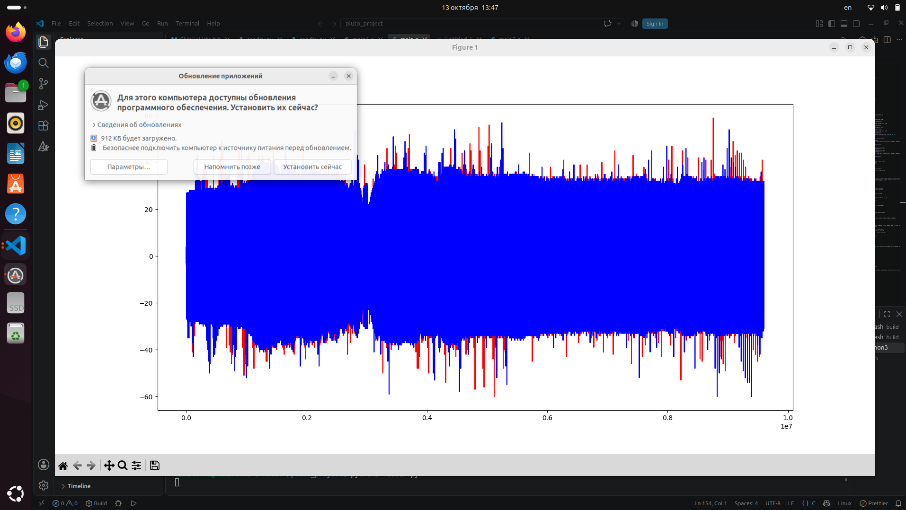
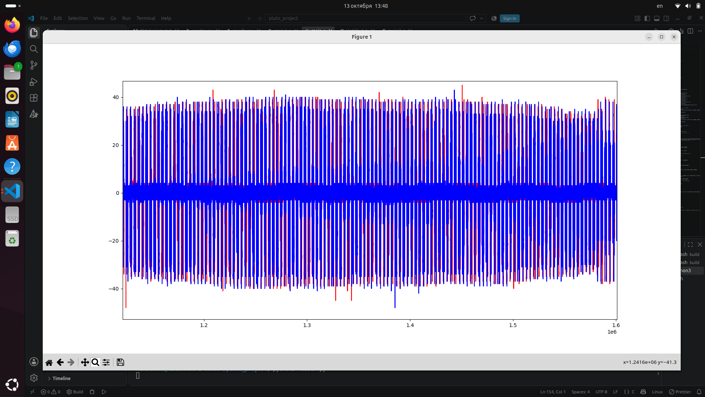
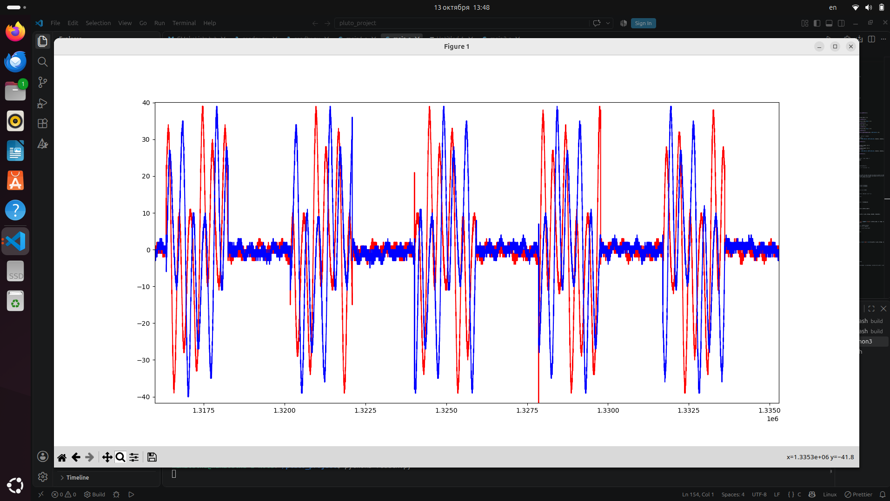

# Неделя 5. Передача и запись сигналов Pluto SDR

## 1. Изменения в программе

В `main.c` настроена работа приёмного и передающего потоков SoapySDR. Частота дискретизации составляет 1 МГц. Программа записывает принятые данные в `pluto1.pcm` и выполняет до 5000 итераций чтения. Изменены частоты передачи данных и логика записи в файл.

## 2. Результаты

На графике показан длинный участок записи. Основная энергия сигнала находится примерно в диапазоне от -35 до +35 условных единиц. По всей длине записи заметны многочисленные узкие выбросы вверх и вниз; некоторые достигают примерно +40 и -60.

На втором графике показан увеличенный отрезок записи. Хорошо видны многочисленные повторяющиеся колебания: верхние пики достигают примерно +40, нижние - около -40.

## 2. Детальный масштаб: группы импульсов

Третий график показывает ещё более короткий интервал. На нём видны отдельные группы колебаний продолжительностью примерно 1920 семплов, что соответствует значениям заданным в программе. Между группами располагаются участки, где обе линии колеблются около нуля и не достигают прежних амплитуд.
