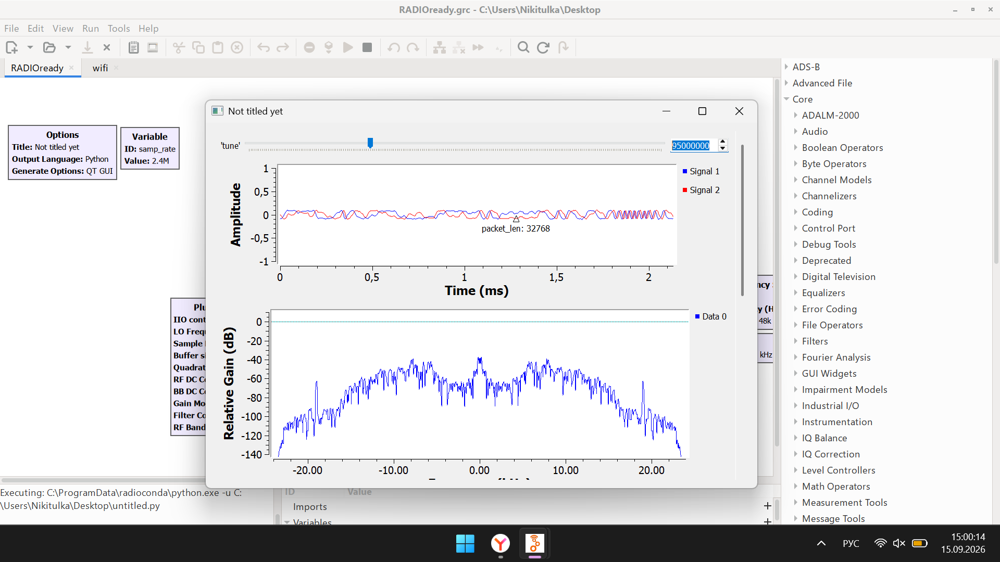

# Неделя 1. Архитектура Adalm Pluto SDR. GNU Radio. Построение радио-приёмника

### 1. Введение в GNU Radio
**GNU Radio** - это инструмент с открытым исходным кодом для разработки программного обеспечения в сфере программно-определяемого радио (SDR). Инструмент позволяет при помощи «строительных блоков» создать конфигурацию радиоустройства, не написав ни одной строчки кода, и запустить программу непосредственно с использованием модуля SDR, например Adalm-Pluto, LimeSDR и др.

В библиотеке имеется широкий спектр функций и методов по цифровой обработке сигнала. Модули написаны на языке C++, а взаимодействие блоков друг с другом - на Python. Приложения можно строить как путём работы с API GNU Radio, так и посредством GUI-приложения **GNU Radio Companion (GRC)**.

## 2. Практика: Построение FM-радиоприёмника

### 2.1. Используемые блоки и их настройка
В GNU Radio Companion был собран проект радиоприёмника (`RADIOforotchet.grc`):
1. **`PlutoSDR Source`**: привязан к устройству через URI `192.168.2.1`. Частота дискретизации задана через переменную `samp_rate = 2.4M`. Несущая частота задается переменной `tune`.
2. **`QT GUI Range (tune)`**: ползунок для перестройки частоты FM-радиостанций в диапазоне 88.7 - 110.1 МГц с шагом 100 кГц.
3. **`Low Pass Filter`**: фильтр низких частот для выделения полосы станции (Cutoff Freq = 100 кГц, переходная полоса = 50 кГц). За счет параметра Decimation = 5 частота дискретизации понижается с 2.4 МГц до 480 кГц.
4. **`WFM Receive`**: блок демодуляции широковещательного ЧМ-сигнала. Внутри настроена децимация звука = 10, что дает частоту 48 кГц (480 кГц / 10).
5. **`Audio Sink`**: вывод полученного аудиопотока на динамики/наушники с частотой дискретизации 48 кГц.
6. **`QT GUI Frequency Sink`** и **`QT GUI Time Sink`**: визуализация спектральной плотности мощности (PSD) и формы сигнала во времени.

### 2.2. Результат работы

Схема была запущена, приёмник настроен на частоту вещания **95.0 МГц**.

По факту работы:
* В верхнем окне отображается осциллограмма демодулированного сигнала во времени (`Signal 1` и `Signal 2`).
* В нижнем окне отображается спектр радиостанции вокруг несущей частоты.
* В наушниках/динамиках воспроизводится звук радиовещания без задержек и артефактов.
