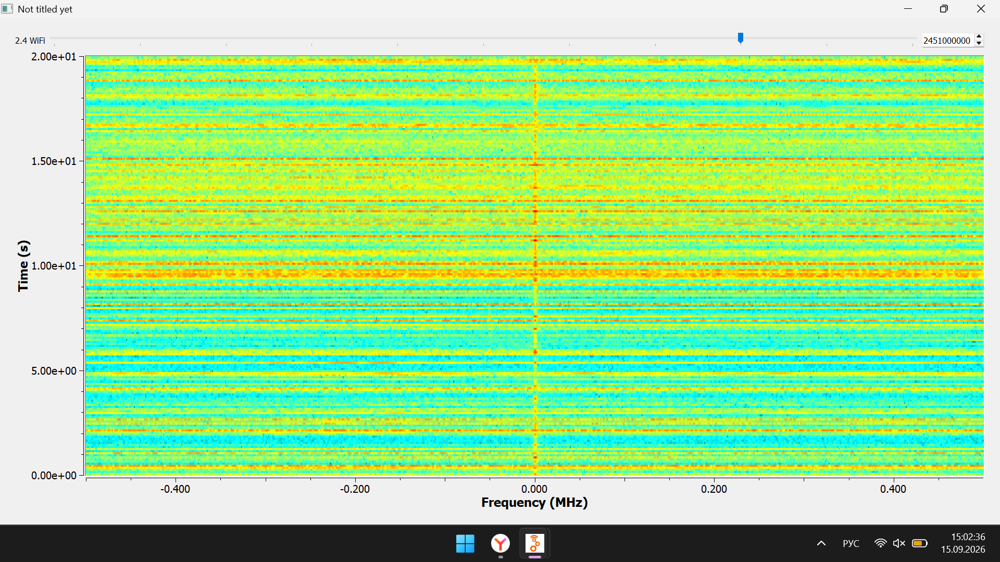

# Неделя 2. Доработка радиоприёмника. Разработка Wi-Fi анализатора

## 1. Теория

### 1.1. Доработка радиоприёмника
* Для удобного поиска станций добавляется переменная управления частотой `tune` через ползунок `QT GUI Range`.

### 1.2. Анализ радиоэфира в диапазоне 2.4 ГГц (Wi-Fi)
* Диапазон Wi-Fi 2.4 ГГц разделен на каналы (от 1 до 13). Шаг между центральными частотами каналов составляет 5 МГц (1 канал - 2412 МГц, ..., 11 канал - 2462 МГц).
* Для наблюдения за активностью эфира во времени применяется спектрограмма (**Waterfall Sink** / водопад). По горизонтали откладывается частота, по вертикали - время, а яркость и цвет полосы показывают уровень мощности сигнала.

---

## 2. Практика: Построение Wi-Fi анализатора

В GNU Radio Companion была собрана схема анализатора спектра (`wifi.grc`):
1. **`Variable (samp_rate)`**: частота дискретизации задана равной 1 МГц (`1e6`).
2. **`QT GUI Range (wifichannel)`**: ползунок для выбора частоты канала Wi-Fi:
   * Диапазон: от 2412 МГц до 2462 МГц
   * Шаг: 5 МГц
   * Значение по умолчанию: 2451 МГц
3. **`PlutoSDR Source`**: приёмник настроен на частоту `int(wifichannel)`, полоса 20 МГц, частота дискретизации 1 МГц, размер буфера 32768.
4. **`QT GUI Waterfall Sink`**

### Результат работы

При запуске `wifi.grc` открывается окно отображения водопада.

По факту работы:
* На частоте 2451 МГц (ползунок `2.4 WiFi`) зафиксирована активность беспроводной сети.
* На графике видны периодические горизонтальные желто-оранжевые линии - это пакеты передачи данных Wi-Fi устройств.

